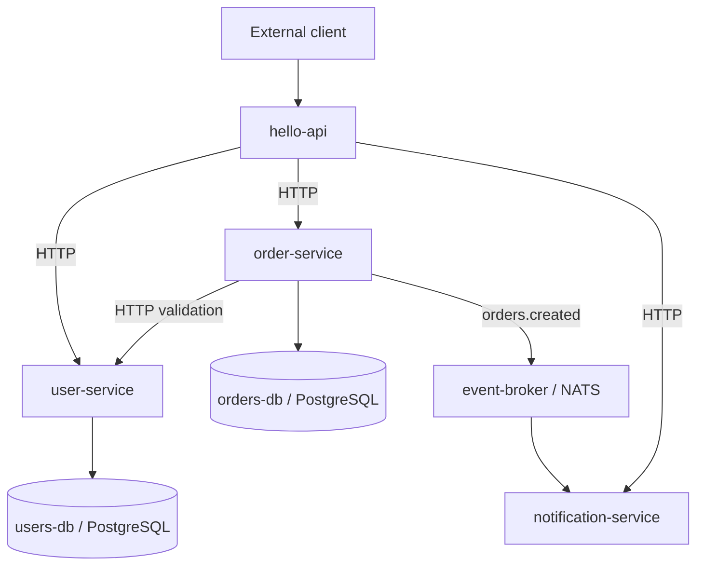

# Hello API

An educational OpenChoreo system demonstrating independently deployable Node.js services, synchronous HTTP dependencies, PostgreSQL resources, and asynchronous NATS events.

## Architecture

`hello-api` is the only externally visible component. The other application endpoints use `project` visibility, while PostgreSQL and NATS are consumed through OpenChoreo Resource outputs.



| Component | Purpose | Application path | Visibility | Dependencies |
|---|---|---|---|---|
| `hello-api` | External API facade | `/` | `external` | `user-service:http`, `order-service:http`, `notification-service:http` |
| `user-service` | User persistence API | `/services/user-service` | `project` | `users-db` |
| `order-service` | Order persistence and event publisher | `/services/order-service` | `project` | `user-service:http`, `orders-db`, `event-broker` |
| `notification-service` | NATS consumer and demo notification store | `/services/notification-service` | `project` | `event-broker` |

| Resource | Type | Purpose |
|---|---|---|
| `users-db` | `postgres` | User-service database named `users` |
| `orders-db` | `postgres` | Order-service database named `orders` |
| `event-broker` | `nats` | Publishes and consumes `orders.created` |

## API facade

The root service listens on `0.0.0.0:8080`, uses Node.js built-in `fetch`, and forwards these routes:

- `GET /health`
- `POST /users`, `GET /users`, `GET /users/:id`
- `POST /orders`, `GET /orders`, `GET /orders/:id`
- `GET /notifications`

It consumes `USER_SERVICE_URL`, `ORDER_SERVICE_URL`, and `NOTIFICATION_SERVICE_URL`. OpenChoreo resolves these values from declared endpoint dependencies; Kubernetes service addresses are never embedded in the code.

## Run locally

Run the facade by itself:

```bash
npm ci
npm start
```

Run the complete disposable Development topology with two PostgreSQL containers and NATS:

```bash
docker compose up --build -d
curl http://localhost:8080/health
curl -X POST http://localhost:8080/users \
  -H "Content-Type: application/json" \
  -d '{"name":"Samuel","email":"samuel@example.com"}'
curl -X POST http://localhost:8080/orders \
  -H "Content-Type: application/json" \
  -d '{"userId":1,"item":"MacBook Pro","quantity":1}'
curl http://localhost:8080/notifications
docker compose down
```

The credentials in `docker-compose.yml` are disposable local-development values only. OpenChoreo receives database credentials and the NATS URL from Resource dependencies.

## OpenChoreo Deployment

### Component metadata

| Field | Value |
|---|---|
| Project | `hello-world-demo` |
| Existing Component Name | `hello-api` |
| Display Name | `Hello API` |
| Component Type | `deployment/service` |
| Deployment method | Build from Source |
| Repository | `https://github.com/xamuel98/hello-openchoreo-demo.git` |
| Branch | `main` |
| Application path | `/` |
| Build workflow | Dockerfile builder |
| Auto deploy | Enabled |

Create the additional components from the same repository using their application paths from the architecture table. All four source directories contain their own `Dockerfile`, `package-lock.json`, tests, and `workload.yaml`.

### Runtime configuration

Every service listens on `0.0.0.0:8080`, exposes an endpoint named `http`, and defaults `APP_ENV` to `development`. Only `hello-api` declares `external` visibility.

### Resource and endpoint dependencies

The source workload descriptors use OpenChoreo v1.3 dependency bindings:

- Endpoint `envBindings.address` supplies complete HTTP URLs.
- PostgreSQL outputs `host`, `port`, `username`, `password`, and `database` map to the corresponding `DB_*` variables.
- The NATS output `url` maps to `NATS_URL`.

Resource credentials are not stored in Git. Development bindings must exist and report Ready before dependent component releases can deploy.

The project-owned resource declarations are in `openchoreo/resources.yaml`. Apply them only after confirming that the platform has the standard `postgres` and `nats` `ClusterResourceType` templates:

```bash
kubectl apply -f openchoreo/resources.yaml
```

Creating these `Resource` objects does not itself deploy infrastructure. OpenChoreo creates a `ResourceRelease`; a platform engineer or GitOps process must then create/advance one `ResourceReleaseBinding` per resource for each environment, starting with `development`. Wait for all three bindings to report `Ready` before deploying `user-service`, `order-service`, or `notification-service`.

### Environment configuration

| Environment | APP_ENV |
|---|---|
| Development | `development` |
| Staging/Test | `staging` |
| Production | `production` |

`development` is the descriptor default. Future environments should override `APP_ENV` through OpenChoreo release bindings while preserving the same images and dependency declarations.

## Quality gates

Run the repository checks:

```bash
npm ci
npm run validate:ci
npm --prefix services/user-service ci
npm --prefix services/user-service test
npm --prefix services/order-service ci
npm --prefix services/order-service test
npm --prefix services/notification-service ci
npm --prefix services/notification-service test
```

Every Dockerfile has a validation stage that runs its service tests before the production stage installs only runtime dependencies. The root gate also validates the README, PRD, TDD, and all four OpenChoreo workload descriptors.

| Artifact | Purpose |
|---|---|
| [`docs/PRD.md`](docs/PRD.md) | Product requirements and acceptance criteria |
| [`docs/TDD.md`](docs/TDD.md) | Technical design and verification strategy |
| [`docker-compose.yml`](docker-compose.yml) | Development-only end-to-end topology |
| [`scripts/validate-docs.js`](scripts/validate-docs.js) | Documentation and workload validation |

The source-build workflow must support descriptor-aware workload generation for OpenChoreo to report `FROM SOURCE: Yes`. Shared workflows are platform-owned and are not modified by this repository.
